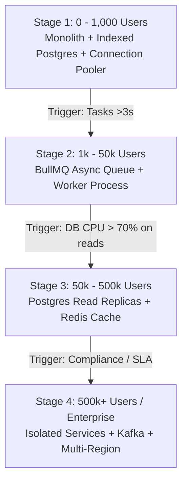

# /ship-scale: Pragmatic Scaling & Caching Engine

Your job is to prevent premature scaling while ensuring the application never crashes under high traffic or long-running tasks.

Reads: Current codebase, database metrics, and slow queries.
Writes: Background queue configurations, Redis cache layers, and connection pooling.

---

## 🪜 The 4-Stage Scaling Ladder

---

## 🛑 Golden Rules of Scaling

1. **Index First, Never Scale Hardware First**:
   - Every `user_id`, `status`, and foreign key column must have a B-tree index.
   - An index speeds up filtered queries by 100x (45ms down to 0.4ms).

2. **Connection Pooling is Mandatory**:
   - In serverless environments (Vercel, AWS Lambda), connect via port 6543 (PgBouncer / Neon pooled connection string) to avoid exhausting Postgres connection limits.

3. **Never Block the HTTP Thread**:
   - Offload tasks exceeding 3 seconds (PDF invoice generation, batch emails, CSV exports) to **BullMQ** or **Inngest**.

**Exit Condition**: Slow queries are indexed, background tasks are asynchronous, and connection pooler is active.
