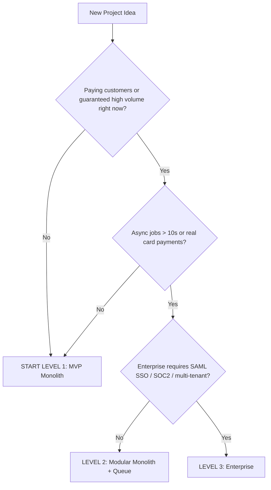

# 🏛️ Guide 01 — Architecture Tiers & Decision Matrix

> 📍 **Where you are**: Guide 01/15 — Architecture · ⬅️ [00 Lifecycle](00_PRODUCT_SHIPPING_OS.md) · [🗺️ Full Journey Map](WHERE_AM_I.md) · ➡️ [02 UX/UI Design](02_UX_UI_DESIGN_SYSTEM.md)

**🎯 After this page you can**: declare "this is Level 1" (or 2/3) with a reason, and fill the entire tech stack table in 1 line each.
**⏱ Read time**: 10 min · **💻 Command blocks**: 0

---

## 💡 The Big Picture (30 seconds)

The most dangerous mismatch is Level-3 infrastructure for a 0-user product (Kubernetes for a validated-idea app) — or Level-1 sloppiness where real money flows (no transactions, corrupted billing). Match technical weight to business stage. Default to the lightest tier; upgrade only on **measured** triggers.

## ⚡ Quick Answer

**99% of first products: Level 1.** Cost estimate: **$0–25/month**.

## ⚖️ Tier Comparison Matrix

| Dimension | 🟢 Level 1 MVP | 🟡 Level 2 Production | 🔴 Level 3 Enterprise |
| :--- | :--- | :--- | :--- |
| Target | Prototype, indie SaaS, validation | $1k–50k MRR SaaS, marketplaces | >1M MAU, SLA-bound contracts |
| Architecture | Single monolith (Next.js / Vite+Node) | Modular monolith + async workers | Event-driven / microservices where isolated |
| Database | Managed Postgres (Supabase/Neon) | + PgBouncer pooler + read replica | Sharded / multi-region (Aurora) |
| Caching | In-memory / HTTP revalidate | Redis (Upstash) for rate limits & hot data | Redis cluster + edge KV |
| Async jobs | Sync or DB queue | BullMQ / Inngest + worker process | Kafka / SQS + dead-letter queues |
| Auth | Managed (Clerk / Better Auth) | RBAC + email verification | SAML/SSO, SCIM, audit logs |
| CI/CD | Git push → auto deploy | GitHub Actions: lint + typecheck + tests | Staging gates, canary, blue-green, Terraform |
| Observability | Console + Sentry free | Sentry + PostHog | Datadog / OTel + PagerDuty + SLOs |

## 🦶 Step by Step

### Step 1 — Run the flowchart above and write down your tier
**✅ Done when**: "We are Level X because Y" fits in one sentence.

### Step 2 — Fill the Level 1 blueprint (your stack contract)

| Decision | Default pick | Alternative |
| :--- | :--- | :--- |
| Frontend + API | Next.js 15 App Router | Vite + React + Hono/Express |
| Database | Postgres on **Supabase** or **Neon** | Render Postgres |
| ORM | **Drizzle** (lightweight, raw-SQL feel) | Prisma |
| Auth | **Clerk** (fastest) / **Better Auth** (your data) | Supabase Auth |
| Payments | **Stripe Checkout** hosted | Lemon Squeezy (handles VAT as MoR) |
| Deploy | **Vercel** / Railway (one container) | Coolify self-hosted |
| Cost | $0–25/month | — |

### Step 3 — Write it into `ARCHITECTURE.md` (Template 2 in [guide 09](09_TEMPLATES_AND_CHECKLISTS.md))
**✅ Done when**: every row above has a concrete name, no "TBD".

### Step 4 — Commit to the Level-1 kill list
Do NOT build: custom checkout UI, Docker/K8s, Redis, or an admin dashboard (Supabase Studio / TablePlus is enough).

## 📈 Upgrade Triggers (evidence, never vibes)

| Path | Upgrade only when |
| :--- | :--- |
| Tier 1 → 2 | DB CPU > 65% peak · sync jobs cause >5s HTTP timeouts · customers need webhook retries + immutable ledger · >2 engineers need PR staging checks |
| Tier 2 → 3 | Contracts refuse without SAML SSO / data residency · 20x read:write traffic and indexes can't hold <100ms ·SOC2/HIPAA/PCI Type-1 audits |

Full Tier-3 stack details (databases, bus, compliance) in the [visual showcase](showcase/fullstack-playbook-visual.html) and the old tier appendix — don't engineer for it until a contract requires it.

## ❌ Common Mistakes

- Picking Level 2 "to be safe" → weeks of Redis/queue setup before the first user validates anything.
- Designing for 10M users before 10 users.
- Treating the stack table as optional — an unwritten stack contract shifts under your feet mid-build.
- Upgrading tiers without the measured trigger row above.

---
> ➡️ **Next**: [02 UX/UI Design](02_UX_UI_DESIGN_SYSTEM.md) — lock colors, spacing and the 7 screen states (plain-English primer inside).
