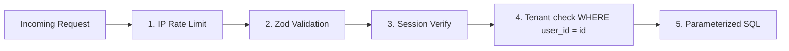

# 🔐 Guide 04 — Authentication & Security

> 📍 **Where you are**: Guide 04/15 — Auth & Security · ⬅️ [03 Database](03_DATABASE_BACKEND_DISCIPLINE.md) · [🗺️ Full Journey Map](WHERE_AM_I.md) · ➡️ [05 Payments](05_PAYMENTS_AND_BILLING.md)

**🎯 After this page you can**: ship bank-grade auth in an afternoon and guarantee User A can never touch User B's data.
**⏱ Read time**: 12 min · **💻 Copy-paste blocks**: 4

---

## 💡 The Big Picture (30 seconds)

Auth should take hours, not weeks: use a proven provider, never write your own crypto. The most catastrophic bug in SaaS isn't leaked passwords — it's **IDOR**: User A edits the URL from `/api/projects/123` to `/api/projects/124` and reads or deletes User B's private data. The fix is one repeated query pattern.

## ⚡ Quick Answer

| Pick | If you want | Free tier |
| :--- | :--- | :--- |
| **Clerk** | Fastest launch, ready-made UI, MFA, teams | 10k MAUs |
| **Supabase Auth** | You already use Supabase Postgres (+RLS) | 50k MAUs |
| **Better Auth** | Full data ownership, self-hosted, no fees | Free |
| Auth0/WorkOS | Enterprise SAML/sell to enterprise later | Low volume free |

**NEVER write your own** password hashing, JWT refresh rotation, or session cookies.

## 🦶 Step by Step

### Step 1 — Install the provider (one command)
```bash
pnpm add @clerk/nextjs        # Clerk: keys from dashboard.clerk.com → .env
pnpm add better-auth && pnpm dlx @better-auth/cli generate   # self-owned
pnpm add @supabase/supabase-js                               # Supabase users
```

### Step 2 — Apply the Golden Pattern to EVERY mutation (memorize this)
```typescript
// ❌ IDOR vulnerability: anyone with the ID can delete
app.delete('/api/projects/:id', async (req, res) => {
  await db.delete(projects).where(eq(projects.id, req.params.id));
});

// ✅ Tenant-scoped: ownership enforced IN the WHERE clause
app.delete('/api/projects/:id', async (req, res) => {
  const userId = req.auth.userId;   // from verified session, never the request body
  const deleted = await db.delete(projects)
    .where(and(eq(projects.id, req.params.id), eq(projects.userId, userId)))
    .returning();

  if (deleted.length === 0) return res.status(404).json({ error: 'Project not found or unauthorized' });
  res.json({ success: true });
});
```

**✅ Done when**: tampering with any resource ID in the URL returns 403/404.

### Step 3 — RBAC without bloat (one enum, not 5 tables)
```typescript
export type UserRole = 'member' | 'admin' | 'owner';

export function requireRole(allowedRoles: UserRole[]) {
  return (req, res, next) => {
    if (!allowedRoles.includes(req.auth.userRole)) {
      return res.status(403).json({ error: 'Forbidden: Insufficient privileges' });
    }
    next();
  };
}
// router.delete('/billing/cancel', requireRole(['owner']), handleCancel);
```

### Step 4 — Guard the request pipeline, in this order


```typescript
// Rate limit on login / forgot-password / checkout
import { Ratelimit } from '@upstash/ratelimit';
const ratelimit = new Ratelimit({
  redis: Redis.fromEnv(),
  limiter: Ratelimit.slidingWindow(5, '60 s'),  // 5 attempts/min
});
const { success } = await ratelimit.limit(ip);
if (!success) throw new Error('Too many requests. Please wait a minute.');
```

### Step 5 — Lock secrets hygiene
```bash
DATABASE_URL="postgresql://..."      CLERK_SECRET_KEY="..."     STRIPE_WEBHOOK_SECRET="whsec_..."
```
- `.env` in `.gitignore` always; ship a `.env.example` with dummy values.
- Public vars only via `NEXT_PUBLIC_`/`VITE_` prefix — verify no SECRET ever has that prefix.

**✅ Done when**: type-safe env validation exists (Template 4 in [guide 09](09_TEMPLATES_AND_CHECKLISTS.md)) and plain-text SQL concatenation appears nowhere (`rg "'\\$\\{" src/` or manual check).

## ⚖️ Injections & XSS (the two classics)

- **SQL injection**: always use ORM/parameterized `$1, $2`. Never: `` db.execute(`SELECT ... '${email}'`) ``
- **XSS**: modern React escapes by default; use `dangerouslySetInnerHTML` only with **DOMPurify**; add CSP headers in production.

## ❌ Common Mistakes

- Trusting IDs from the request instead of the session — the IDOR express: `WHERE id = $1` missing `AND user_id = $2`.
- Rate-limiting frontend only — the API is what gets hammered.
- Caching user data without the user scope (one tenant's dashboard data leaking to another).
- Returning 500 with stack traces in production — generic messages, details to Sentry.
- `.env` accidentally committed once = rotate every key, forever suspicious.

---
> ➡️ **Next**: [05 Payments & Billing](05_PAYMENTS_AND_BILLING.md) — hosted checkout, verified webhooks, idempotency.
