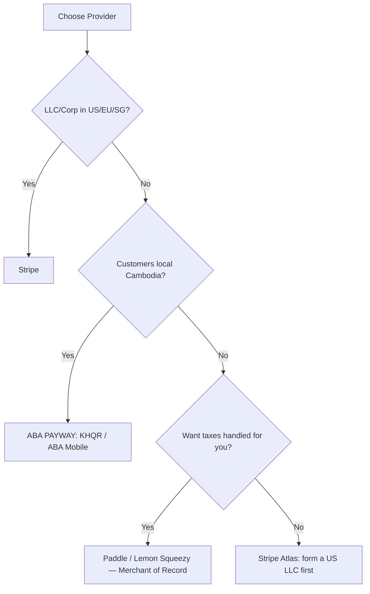

# 💳 Guide 05 — Payments, Billing & Webhooks

> 📍 **Where you are**: Guide 05/15 — Payments · ⬅️ [04 Auth & Security](04_AUTH_AND_SECURITY.md) · [🗺️ Full Journey Map](WHERE_AM_I.md) · ➡️ [06 Scaling & DevOps](06_SCALING_AND_DEVOPS.md)

**🎯 After this page you can**: take money safely — hosted checkout, webhook-only activation, idempotent event handling — with Stripe, Paddle, Lemon Squeezy, or ABA PAYWAY.
**⏱ Read time**: 15 min · **💻 Copy-paste blocks**: 3 + Stripe CLI block

---

## 💡 The Big Picture (30 seconds)

Payments is where software touches real money: double credits, lost revenue, fraud. Two architecture decisions prevent 95% of disasters: (1) use a **hosted checkout** and (2) activate paid access **only from a verified server-to-server webhook, processed idempotently** — never from what the user's browser shows you.

## ⚡ Quick Answer



| Provider | Model | Tax | Best for |
| :--- | :--- | :--- | :--- |
| **Stripe** | Gateway (you're the seller) | You handle (or Stripe Tax) | Global SaaS, custom flows |
| **Paddle** | Merchant of Record | Handled for you | Subscriptions, no legal paperwork |
| **Lemon Squeezy** | Merchant of Record | Handled for you | Indie SaaS, digital goods |
| **ABA PAYWAY** | Local gateway (Cambodia) | Local tax dept | KHQR, Cambodian market |

**Gateway vs MoR in one line**: with Stripe *you* are the seller and owe VAT compliance everywhere; with Paddle/Lemon Squeezy *they* legally sell, handle tax and fraud — you just receive payouts.

## 🦶 Step by Step

### Step 1 — Install + create the checkout endpoint
```bash
pnpm add stripe
```
Backend-only: never put secret keys near the client; only your server creates the checkout session.

### Step 2 — Make every webhook idempotent (the code that saves you)
```typescript
export async function handleWebhookEvent(event: { id: string; type: string; data: any }) {
  const existing = await db.select()
    .from(processedWebhooks)
    .where(eq(processedWebhooks.eventId, event.id));

  if (existing.length > 0) return { status: 'already_processed' }; // gateway stopped retrying

  await db.transaction(async (tx) => {
    await tx.update(users)
      .set({ subscriptionTier: 'pro' })
      .where(eq(users.stripeCustomerId, event.data.customer));

    await tx.insert(processedWebhooks).values({ eventId: event.id, eventType: event.type, processedAt: new Date() });
  });

  return { status: 'success' };
}
```
Gateways re-send events your server didn't acknowledge in ~5s. Without the check above, one retry = double credit.

### Step 3 — Write the ledger row (never just flip `is_pro = true`)
Immutable `orders` table: `user_id, provider, external_transaction_id, amount_in_cents, currency, status (pending|succeeded|failed|refunded), created_at`. Refunds/disputes are answered from this table.

### Step 4 — Handle all 4 subscription events
| Event | Your action |
| :--- | :--- |
| `checkout.session.completed` | Grant Pro access |
| `invoice.payment_succeeded` | Extend expiry |
| `invoice.payment_failed` | Set `past_due`, email user to update card |
| `customer.subscription.deleted` | Revoke Pro, downgrade to free |

### Step 5 — Test in sandbox (Stripe CLI)
```bash
stripe login
stripe listen --forward-to localhost:3000/api/webhooks/stripe   # keep running

stripe trigger checkout.session.completed
stripe trigger invoice.payment_succeeded
stripe trigger customer.subscription.deleted

# Test cards on the checkout page:
# 4242 4242 4242 4242 -> succeeds instantly
# 4000 0000 0000 0002 -> declined
# 4000 0027 6000 3184 -> requires 3DS challenge
```

**✅ Done when**: sandbox purchase upgrades the account, duplicate event replay does NOT double-credit, and a real declined card shows a friendly state.

## 🇰🇭 ABA PAYWAY (Cambodia/Southeast Asia)

Flow: server builds request → `HMAC-SHA512` hash of alphabetized params (merchant_id, tran_id, amount + api_key) → show KHQR code → customer approves in ABA Mobile → server-to-server push → **verify signature before crediting** → return 200. Always specify currency explicitly (`USD`/`KHR`). Get `merchant_id` + `api_key` by applying for an ABA Merchant Account.

## ❌ Common Mistakes

- Unsubscribing users by trusting `?return_url=success` — anyone can type that URL; access comes ONLY from verified webhooks.
- Verifying the signature *after* processing instead of before.
- Storing amounts as floats → rounding drift forever; integer cents.
- Sending any `200 OK` to unverified webhooks — silence or 400 for fakes.
- Testing only checkout success — declined cards, subscription cancellations, and replays are where refunds hurt.
- Custom-built checkout UI in an MVP — hosted checkout is PCI-DSS scope reduction for free.

---
> ➡️ **Next**: [06 Scaling & DevOps](06_SCALING_AND_DEVOPS.md) — know exactly when (and when never) to add infrastructure.
