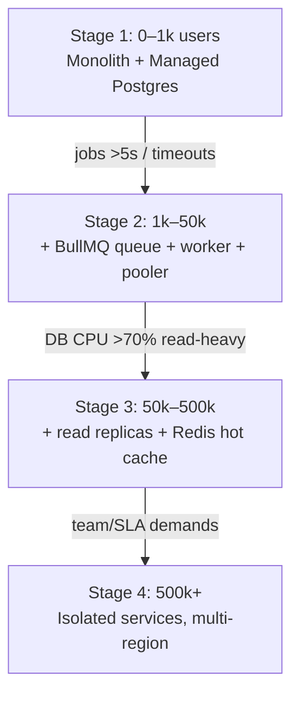

# 📈 Guide 06 — Scaling, Caching & DevOps

> 📍 **Where you are**: Guide 06/15 — Scaling & DevOps · ⬅️ [05 Payments](05_PAYMENTS_AND_BILLING.md) · [🗺️ Full Journey Map](WHERE_AM_I.md) · ➡️ [07 Bug Fixing](07_BUG_FIXING_AND_HARDENING.md)

**🎯 After this page you can**: name your current scaling stage, know the measured trigger for the next one, and run deploys that can't break production.
**⏱ Read time**: 12 min · **💻 Copy-paste blocks**: 3 (cache, CI/CD, deploys)

---

## 💡 The Big Picture (30 seconds)

Everyone asks "will it scale to 10M users?" Reality: **a properly indexed Postgres on $20/month handles 5,000–10,000 requests/minute.** Premature scaling burns months on distributed complexity. Scale only when telemetry demands it — the ladder below tells you exactly when.

## ⚡ Quick Answer — The 4-Stage Ladder



**You need zero of this until Stage 1 hurts.** Adding indexes today is worth more than any cache.

## 🦶 Step by Step (Stage 1 — where you live now)

### Step 1 — Index everything users filter by
Every `user_id`, `status`, FK column: `CREATE INDEX ...` ([why in guide 03 §4](03_DATABASE_BACKEND_DISCIPLINE.md)). 45ms → 0.4ms.

### Step 2 — Never block the HTTP thread on slow work
```typescript
// Fast: fire email without awaiting it – HTTP responds immediately
void sendWelcomeEmail(user.email);
return res.json({ success: true });
```

### Step 3 — Use the pooled connection string
Supabase port `6543` (or Neon's pooler URL) — serverless functions exhaust Postgres connections otherwise.

### Step 4 — Set up the 3 instruments you deploy with (non-negotiable)
| Tool | What it catches |
| :--- | :--- |
| **Sentry** | Unhandled exceptions, with stack trace + user session |
| **PostHog** | Funnel: Visitor → Signup → Checkout → Paid + session replay |
| **`/api/health` endpoint** | 200 OK + DB status; pinned by an uptime monitor (BetterStack / UptimeRobot) |

### Step 5 — When you hit Stage 2 triggers → queue

Add BullMQ (Redis) or Inngest: `POST /api/reports/generate` returns `202 Accepted {jobId}` immediately; worker does the heavy lifting, uploads to storage, notifies the user. HTTP never waits >3s again.

### Step 6 — When you hit Stage 3 triggers → cache + replicas

```typescript
const cacheKey = `dashboard:${userId}`;
const cached  = await redis.get(cacheKey);
if (cached) return JSON.parse(cached);

const data = await calculateHeavyAnalytics(userId);
await redis.set(cacheKey, JSON.stringify(data), 'EX', 60);  // 60s TTL
return data;
```

Reads (`SELECT`) → read replica; writes stay on primary.

## ⚙️ CI/CD — the gate that keeps broken code out of production

```yaml
# .github/workflows/deploy.yml
name: CI/CD Pipeline
on:
  push: { branches: [main] }
  pull_request: { branches: [main] }

jobs:
  validate:
    runs-on: ubuntu-latest
    steps:
      - uses: actions/checkout@v4
      - uses: pnpm/action-setup@v3
        with: { version: 9 }
      - uses: actions/setup-node@v4
        with: { node-version: 20, cache: pnpm }
      - run: pnpm install --frozen-lockfile
      - run: pnpm lint && pnpm typecheck && pnpm test

  deploy:                       # migrations + deploy, only after green
    needs: validate
    if: github.ref == 'refs/heads/main' && github.event_name == 'push'
    runs-on: ubuntu-latest
    steps:
      - run: pnpm db:migrate    # env DATABASE_URL from secrets
      - run: pnpm deploy:prod   # VERCEL_TOKEN etc. from secrets
```

Run the same checks locally **before** you push:

```bash
pnpm lint && pnpm typecheck && pnpm test
vercel --prod     # or: railway up | fly deploy
```

**✅ Done when**: a PR with a failing test physically cannot reach main.

## ❌ Common Mistakes

- Redis on day 1 → cache invalidation bugs for data that Postgres handles fine — Telemetry-First.
- Sending emails inline in the request (user waits 4s) → background it.
- Deploying without migrations as a gate → schema drifts between live DB and code.
- Ignoring logs until a user says "the site's down" — the `/api/health` monitor is one step of prevention ahead of a thousand patch cures.
- Scaling "in case of a viral tweet" — virality is a post-launch bonus problem; ship first.

---
> ➡️ **Next**: [07 Bug Fixing](07_BUG_FIXING_AND_HARDENING.md) — the 15-minute surgical protocol for when (not if) it breaks.
