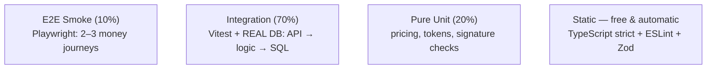

# 🧪 Guide 10 — Pragmatic Testing & QA

> 📍 **Where you are**: Guide 10/15 — Testing · ⬅️ [09 Templates](09_TEMPLATES_AND_CHECKLISTS.md) · [🗺️ Full Journey Map](WHERE_AM_I.md) · ➡️ [11 Files & Emails](11_FILES_STORAGE_AND_EMAILS.md)

**🎯 After this page you can**: get 95% launch confidence with ~10% testing effort — 3 test types, zero brittle mock bloat.
**⏱ Read time**: 12 min · **💻 Copy-paste blocks**: 3 test patterns + commands

---

## 💡 The Big Picture (30 seconds)

Two failure modes: **zero tests** (45 minutes of manual clicking per deploy, silent payment breakage, fear of shipping) and **100% coverage obsession** (brittle tests for button colors, mocked-DB "tests" that pass while real SQL fails, 80% of time on test maintenance). The pragmatic middle: test behavior and money; skip static DOM.

## ⚡ Quick Answer — the Testing Trophy



| Type | ROI |
| :--- | :--- |
| Static typing | **Maximum** — free bug catching |
| Integration with real Postgres | **Highest** — catches broken SQL, auth leaks, validation |
| Unit (pure logic only) | High for pricing/crypto; zero for glue code |
| E2E | Critical for the 2–3 flows that make/lose money |

**Setup & daily commands:**
```bash
pnpm add -D vitest
pnpm add -D @playwright/test && npx playwright install chromium

pnpm vitest            # watch mode
pnpm vitest run        # one-shot (CI)
npx playwright test --headed      # watch the browser click itself
npx playwright codegen localhost:3000   # record tests by clicking around
```

## 🦶 Step by Step

### Step 1 — Write the ONE integration test pattern per slice (route + real DB)
```typescript
import { describe, it, expect, beforeEach } from 'vitest';

describe('POST /api/projects (slice integration)', () => {
  let userAliceId = 'user_alice_123', userBobId = 'user_bob_456';

  beforeEach(async () => {
    await db.delete(projects); await db.delete(users);
    await db.insert(users).values([
      { id: userAliceId, email: 'alice@example.com' },
      { id: userBobId, email: 'bob@example.com' },
    ]);
  });

  it('creates a project scoped to the authenticated user', async () => {
    const req = new Request('http://localhost:3000/api/projects', {
      method: 'POST',
      headers: { 'Content-Type': 'application/json' },
      body: JSON.stringify({ name: 'Alpha Launch' }),
    });
    const res = await handleCreateProject(req, userAliceId);
    expect(res.status).toBe(201);

    const body = await res.json();
    expect(body.data.userId).toBe(userAliceId);

    const saved = await db.select().from(projects).where(eq(projects.id, body.data.id));
    expect(saved).toHaveLength(1);
  });

  it('rejects empty name with 400', async () => {
    const req = new Request('http://localhost:3000/api/projects', {
      method: 'POST',
      headers: { 'Content-Type': 'application/json' },
      body: JSON.stringify({ name: '' }),
    });
    expect((await handleCreateProject(req, userAliceId)).status).toBe(400);
  });
});
```

### Step 2 — The money test: webhook idempotency (no test below = fear of launching)
```typescript
it('upgrades user and ignores duplicate webhook replay', async () => {
  const [user] = await db.insert(users).values({
    id: 'usr_paid_1', email: 'customer@test.com',
    stripeCustomerId: 'cus_xyz_123', subscriptionTier: 'free',
  }).returning();

  const mockEvent = {
    id: 'evt_test_charge_success_999',
    type: 'checkout.session.completed',
    data: { customer: 'cus_xyz_123' },
  };

  expect((await handleWebhookEvent(mockEvent)).status).toBe('success');           // 1st delivery
  const updated = await db.query.users.findFirst({ where: eq(users.id, user.id) });
  expect(updated?.subscriptionTier).toBe('pro');

  expect((await handleWebhookEvent(mockEvent)).status).toBe('already_processed'); // replay
  const ledger = await db.select().from(processedWebhooks).where(eq(processedWebhooks.eventId, mockEvent.id));
  expect(ledger).toHaveLength(1);
});
```

### Step 3 — ONE Playwright smoke test (the complete funnel)
```typescript
import { test, expect } from '@playwright/test';

test('Critical user journey', async ({ page }) => {
  await page.goto('/');
  await page.getByRole('button', { name: /Get Started/i }).click();

  await page.getByLabel(/Email/i).fill('testuser@example.com');
  await page.getByLabel(/Password/i).fill('Password123!');
  await page.getByRole('button', { name: /Sign In/i }).click();
  await expect(page).toHaveURL(/\/dashboard/);

  await page.getByRole('button', { name: /\+ New Project/i }).click();
  await page.getByPlaceholder(/Project Name/i).fill('Smoke Test Project');
  await page.getByRole('button', { name: /Create/i }).click();

  await expect(page.getByText('Smoke Test Project')).toBeVisible();
});
```

**✅ Done when**: `pnpm vitest run && npx playwright test` green in <60s, and [09's Test Plan template](09_TEMPLATES_AND_CHECKLISTS.md) has its boxes ticked.

## ⚖️ Test / Don't Test

| ❌ Never | ✅ Always |
| :--- | :--- |
| Static UI ("h1 says Dashboard") | Tenant isolation: A touching B's data → 404/403 |
| Library internals (Clerk hashing, Drizzle SELECT) | Money: webhook signature + idempotency |
| Trivial getters/wrappers | Business formulas: pricing, discounts, quotas |
| Mocking your own DB (hides FK/type/migration breakage) | E2E primary journey: sign up → core action → see result |

## 🚦 Minimum gates per delivery level

| Level | Required | Exit gate |
| :--- | :--- | :--- |
| 1 (MVP) | typecheck + core slice integration + webhook idempotency | CI <60s green + manual browser smoke |
| 2 (Production) | full integration suite + Playwright on every PR + migration rollback check | zero failing tests before merge |
| 3 (Enterprise) | + cross-tenant isolation, k6 load @1k rps, fuzz + dep vuln scan | canary gates on error budget |

## ❌ Common Mistakes

- Snapshot testing every component render → test churn on every tiny change.
- Mocking Postgres → tests pass while real SQL is broken (the deadliest false confidence).
- 50 E2E tests nobody can keep green — 1–2 resilient ones beat 50 brittle ones.
- Only testing on desktop, full window, instant network → mobile/3G users find breakage at launch.

---
> ➡️ **Next**: [11 Files, Storage & Emails](11_FILES_STORAGE_AND_EMAILS.md) — uploads that don't crash, emails that reach the Inbox.
