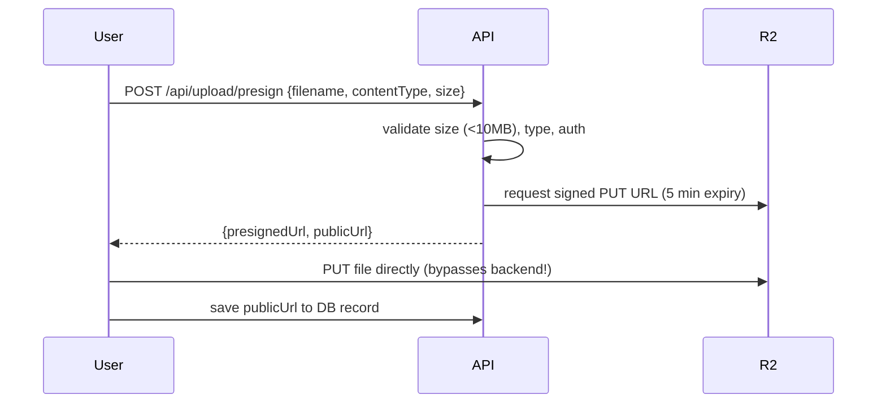

# 📤 Guide 11 — File Storage, Uploads & Transactional Emails

> 📍 **Where you are**: Guide 11/15 — Files & Emails · ⬅️ [10 Testing](10_TESTING_AND_QA_STRATEGY.md) · [🗺️ Full Journey Map](WHERE_AM_I.md) · ➡️ [12 SEO & Analytics](12_SEO_METADATA_AND_ANALYTICS.md)

**🎯 After this page you can**: add uploads that never crash your server and emails that never land in spam.
**⏱ Read time**: 12 min · **💻 Copy-paste blocks**: 3 (setup, presign, email)

---

## 💡 The Big Picture (30 seconds)

Two risky integrations everyone ships dangerously: **uploads** (streaming through your serverless API crashes memory and dies on Vercel's 4.5MB request limit) and **emails** (basic SMTP = 100% spam folder). Both have one correct pattern each: **presigned direct upload** and **SPF+DKIM+DMARC**.

## ⚡ Quick Answer

- **Storage**: Cloudflare R2 — zero egress fees, S3-compatible. Default in 2026.
- **Email**: Resend (React Email) for developer velocity; Postmark for deliverability purists.
- **Never**: proxy file bytes through your API route.

## 🦶 Step by Step

### Part A — Uploads via Presigned URL

**A1. Setup:**
```bash
pnpm add -g wrangler
pnpm add @aws-sdk/client-s3 @aws-sdk/s3-request-presigner

wrangler login
wrangler r2 bucket create myapp-uploads
# API keys: Cloudflare Dashboard → R2 → Manage R2 API Tokens → "Object Read & Write"
# .env: R2_ACCOUNT_ID, R2_ACCESS_KEY_ID, R2_SECRET_ACCESS_KEY, R2_BUCKET_NAME, R2_PUBLIC_DOMAIN
```

**A2. The flow (browser → R2 directly, server only signs):**


**A3. Copy the presign route:**
```typescript
import { S3Client, PutObjectCommand } from '@aws-sdk/client-s3';
import { getSignedUrl } from '@aws-sdk/s3-request-presigner';
import crypto from 'crypto';

const s3 = new S3Client({
  region: 'auto',
  endpoint: `https://${process.env.R2_ACCOUNT_ID}.r2.cloudflarestorage.com`,
  credentials: {
    accessKeyId: process.env.R2_ACCESS_KEY_ID!,
    secretAccessKey: process.env.R2_SECRET_ACCESS_KEY!,
  },
});

export async function createPresignedUploadUrl(userId: string, filename: string, contentType: string) {
  const ALLOWED_TYPES = ['image/jpeg', 'image/png', 'image/webp', 'application/pdf'];
  if (!ALLOWED_TYPES.includes(contentType)) throw new Error('Unsupported file type');

  const fileExt = filename.split('.').pop() || 'bin';
  const fileKey = `uploads/${userId}/${crypto.randomUUID()}.${fileExt}`;  // random key: no overwrites

  const command = new PutObjectCommand({ Bucket: process.env.R2_BUCKET_NAME!, Key: fileKey, ContentType: contentType });
  const uploadUrl = await getSignedUrl(s3, command, { expiresIn: 300 });

  return { uploadUrl, publicUrl: `${process.env.R2_PUBLIC_DOMAIN}/${fileKey}`, fileKey };
}
```

**✅ Done when**: a 10MB upload succeeds where 4.5MB chunking used to fail.

### Part B — Emails that reach the Inbox

**B1. The 3 mandatory DNS records** (before any real email; at your registrar):

| Record | Type | Name | Value |
| :--- | :--- | :--- | :--- |
| SPF | TXT | `@` | `v=spf1 include:amazonses.com include:_spf.resend.com ~all` |
| DKIM | CNAME/TXT | (from Resend dashboard) | cryptographic signature, proves non-spoofing |
| DMARC | TXT | `_dmarc` | `v=DMARC1; p=none; rua=mailto:dmarc-reports@yourapp.com` |

**B2. Setup + send:**
```bash
pnpm add resend
# 1. resend.com → Domains → add domain → paste DKIM/SPF records → wait green
# 2. API key → .env as RESEND_API_KEY
```
```typescript
import { Resend } from 'resend';
const resend = new Resend(process.env.RESEND_API_KEY);

export const Mailer = {
  async sendWelcome(email: string, name: string) {
    try {
      const { data, error } = await resend.emails.send({
        from: 'MyApp <hello@yourapp.com>',
        to: [email],
        subject: `Welcome to the platform, ${name}!`,
        html: `<div style="font-family:sans-serif;max-width:600px;margin:0 auto;padding:20px;">
          <h2>Welcome aboard, ${name}!</h2>
          <a href="https://yourapp.com/dashboard" style="display:inline-block;background:#6366f1;color:#fff;padding:12px 24px;border-radius:8px;text-decoration:none;font-weight:bold;">Open Dashboard →</a>
        </div>`,
      });
      if (error) console.error('Email failed:', error);
      return data;
    } catch (err) { console.error('Email exception:', err); }
  },
};
```
Fire emails without blocking HTTP: `void Mailer.sendWelcome(...)` (see [guide 06](06_SCALING_AND_DEVOPS.md)).

**✅ Done when**: a test email arrives in a real Gmail **Inbox** (check promotions tab too).

## ⚖️ Provider Checklist

| Storage | Egress | Best for |
| :--- | :--- | :--- |
| **Cloudflare R2** | **$0/GB** | default choice — no bandwidth bills |
| AWS S3 | $0.09/GB | AWS enterprise ecosystems |
| UploadThing | free tier → paid | fastest Next.js setup |
| Supabase Storage | in Pro | if already on Supabase |

## ❌ Common Mistakes

- Uploading through the API route → 4.5MB wall (Vercel) + memory crashes.
- No MIME whitelist on presign → anyone hosts anything on your bucket.
- Predictable file keys → users overwrite each other's files.
- Skipping DMARC → deliverability silently degraded.
- Emails from `gmail.com`/`resend.dev` addresses instead of `@yourapp.com` — instant spam.
- Awaiting the email send inside the request → user stares at a spinner (background it).

---
> ➡️ **Next**: [12 SEO & Analytics](12_SEO_METADATA_AND_ANALYTICS.md) — make the launch link look premium in feeds and know where the funnel leaks.
