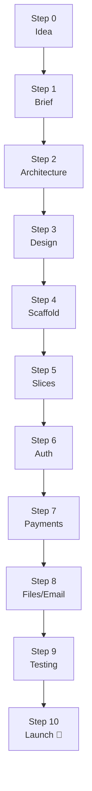

# 🚀 Product Shipping Operating System (FullStack Playbook)

> **"Never spend 3 weeks building infrastructure for a product that hasn't validated its first user."**

A reusable blueprint for taking any software idea from blank screen to production — without infinite backend tweaking, redesign loops, or speculative over-engineering.

---

## 🎯 Start Here (choose one)

| If you are... | Open this | Why |
| :--- | :--- | :--- |
| 😵 Lost / don't know what to type next | [**🗺️ WHERE_AM_I.md**](WHERE_AM_I.md) | Ordered checklist, every command, tick boxes as save game |
| 🆕 Starting a brand new idea | [Guide 00](00_PRODUCT_SHIPPING_OS.md) | The 6-phase lifecycle that stops drift |
| 🤖 Working with a coding AI | [Guide 08](08_PROMPT_LIBRARY_AND_RECIPES.md) | Copy-paste prompts for every phase |
| 👀 Just browsing the visual view | [showcase/fullstack-playbook-visual.html](showcase/fullstack-playbook-visual.html) | Interactive dashboard, no server needed |

---

## 🧭 One-Screen Map of the Whole System



The **15 numbered guides are reference manuals** (read as needed) — the **[🗺️ step-by-step order](WHERE_AM_I.md)** is the actual path you execute.

---

## 📚 The 15 Guides

| # | Guide | What it answers | When you open it |
| :--- | :--- | :--- | :--- |
| 00 | [Lifecycle & Rules](00_PRODUCT_SHIPPING_OS.md) | Which phase am I in? Can I move on? | Every planning session |
| 01 | [Architecture Tiers](01_ARCHITECTURE_TIERS.md) | MVP, Production or Enterprise? | Before any code |
| 02 | [UX/UI Design](02_UX_UI_DESIGN_SYSTEM.md) | What colors/spacing/states? Plain-English primer inside | Before styling |
| 03 | [Database Discipline](03_DATABASE_BACKEND_DISCIPLINE.md) | Which tables? How to migrate? | When touching a schema |
| 04 | [Auth & Security](04_AUTH_AND_SECURITY.md) | Which provider? How to stop IDOR? | Before login exists |
| 05 | [Payments & Billing](05_PAYMENTS_AND_BILLING.md) | Stripe/Paddle/ABA? Webhooks safely? | Before charging money |
| 06 | [Scaling & DevOps](06_SCALING_AND_DEVOPS.md) | When to add Redis/queues? CI/CD? | After 1,000+ users |
| 07 | [Bug Fixing](07_BUG_FIXING_AND_HARDENING.md) | How to fix in 15 min, not 3 days? | Every time something breaks |
| 08 | [Prompt Library](08_PROMPT_LIBRARY_AND_RECIPES.md) | What exactly do I tell the AI? | Every AI session |
| 09 | [Templates & Checklists](09_TEMPLATES_AND_CHECKLISTS.md) | Briefs, specs, the 15-point launch gate | Writing docs / pre-launch |
| 10 | [Testing & QA](10_TESTING_AND_QA_STRATEGY.md) | The 4 tests that give 95% confidence | Before merge / launch |
| 11 | [Files & Emails](11_FILES_STORAGE_AND_EMAILS.md) | Uploads without crashes, emails that reach Inbox | First upload / email |
| 12 | [SEO & Analytics](12_SEO_METADATA_AND_ANALYTICS.md) | OG cards, sitemap, 4 funnel events | Before announcing |
| 13 | [Apple Design & 3D](13_APPLE_DESIGN_SYSTEM_AND_3D_ASSETS.md) | Frosted glass, springs, bento, 3D stickers | Building a landing page |
| 14 | [Proven UI Patterns](14_PROVEN_UI_PATTERNS_AND_MICRO_INTERACTIONS.md) | Sounds, sliders, guardrails, category colors | Adding craft details |

**Bonus**: [UX_UI_SPEC.md](UX_UI_SPEC.md) — a finished, steal-this Apple-grade UI spec (example output of Prompt B from guide 08).

---

## ⚡ The 5 Golden Rules

1. **Vertical slices, never horizontal layers.** Build UI + API + DB + test for ONE feature fully before starting the next. Never "all tables first".
2. **One tier at a time.** Start Level 1 (MVP). Upgrade only when telemetry proves a bottleneck (see [guide 06](06_SCALING_AND_DEVOPS.md)).
3. **Never trust webhooks without idempotency.** Paid status is granted only by a verified server-to-server webhook ([guide 05](05_PAYMENTS_AND_BILLING.md)).
4. **Surgical bug fixes, no refactoring.** Reproduce → isolate → <20-line patch → test ([guide 07](07_BUG_FIXING_AND_HARDENING.md)).
5. **Definition of Done = browser-tested + validated + 3 states + transactions.** Checkpoint in every guide's "✅ Done when".

---

## 🛠️ 2026 Default Stack (if you have no strong preference)

**Next.js 15 · Tailwind or CSS tokens · Supabase/Neon Postgres · Drizzle ORM · Clerk or Better Auth · Stripe (or ABA PAYWAY for Cambodia) · Vercel/Railway · Sentry + PostHog**

Full reasoning in [guide 01](01_ARCHITECTURE_TIERS.md).

---

## 🖥️ Visual Versions

- 🎨 **UX/UI Visual Explainer**: [showcase/playbook-ux-visual.html](showcase/playbook-ux-visual.html) — *renders the design system live: token swatches, the 4-layer layout mock, and all 7 UI states as real UI*
- ❓ **"How do I read the spec?"** → [UX_UI_SPEC.md](UX_UI_SPEC.md) now starts with 3 exact ways to use it (steal / feed to AI / regenerate)
- 🌐 Standalone HTML dashboard: [showcase/fullstack-playbook-visual.html](showcase/fullstack-playbook-visual.html)
- 🎭 Apple SaaS showcase: [showcase/apple-saas-showcase.html](showcase/apple-saas-showcase.html)
- ⚛️ Next.js dashboard in [apps/web](apps/web):

```bash
pnpm web:dev   # http://localhost:3005
```

## 📦 Register the Skills (slash commands in your AI chat)

```bash
# Windows (PowerShell)
powershell -ExecutionPolicy Bypass -File ./scripts/install-skills.ps1

# macOS / Linux
bash ./scripts/install-skills.sh
```

Unlocks: `/ship-mvp` `/ship-arch` `/ship-design` `/ship-slice` `/ship-pay` `/ship-test` `/ship-scale` `/ship-audit` `/ship-fix`

---

## 🤝 Contributing

Read [CONTRIBUTING.md](CONTRIBUTING.md). Distributed under the [MIT License](LICENSE).
