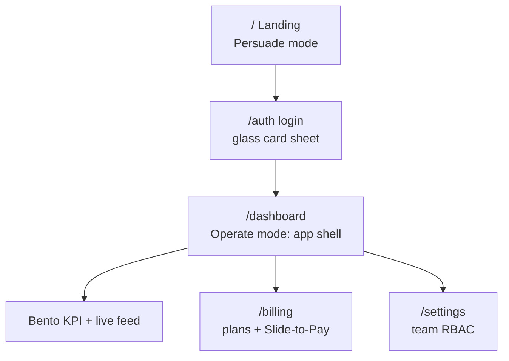

# 🍎 UX_UI_SPEC.md — The Design Contract (Artifact)

> 📍 **Where you are**: Artifact of the Playbook · ⬅️ [02 Design System](02_UX_UI_DESIGN_SYSTEM.md) · [🗺️ Full Journey Map](WHERE_AM_I.md) · ➡️ [03 Database](03_DATABASE_BACKEND_DISCIPLINE.md)

**🎯 What this is**: a complete, ready-to-use Apple-grade UI/UX specification — the finished output of [Prompt B in guide 08](08_PROMPT_LIBRARY_AND_RECIPES.md).
**👀 See it live**: [showcase/playbook-ux-visual.html](showcase/playbook-ux-visual.html) renders every section of this file as actual UI. Open in any browser.

---

## 💡 How to Use This File (3 ways)

| You want to... | Do this |
| :--- | :--- |
| Steal the whole design | Copy this file into your own project repo, rename product-specific bits |
| Give it to your coding AI | Paste it (or link the file) as reference alongside [Prompt D / I](08_PROMPT_LIBRARY_AND_RECIPES.md) |
| Generate your own version | Run Prompt B with your product's brief; this file becomes the quality example |

> **Status**: Approved design contract — edit tokens once, and every screen follows.

---

## ⚡ Quick Answer

- Look: **Cupertino / VisionOS** — dark canvas, frosted glass, spring motion, bento grids
- Fonts: `Outfit` (display) + `Inter` (body) + `JetBrains Mono` (code)
- Canvas: `#090a10` · Glass: white at 4–12% opacity over blur(28px) · Accents: pink/emerald/sky/violet per domain
- Rules: ONE primary CTA per page · 7 states per screen · sound only on confirm/error · slide-to-confirm for money actions

## 🧭 Page Map & Route Hierarchy



| Route | Purpose | Key element |
| :--- | :--- | :--- |
| `/` | Landing — hero + bento features + live demo | Ambient lighting, bento grid |
| `/auth` | Centered glass auth card | Google / email magic link |
| `/dashboard` | The operational cockpit | Floating dock, bento summary, data feed |
| `/billing` | Plan cards + monthly/annual toggle | **Slide-to-Confirm** payment trigger |

## 🎨 Design Tokens (paste into `globals.css`)

```css
:root {
  /* Typography */
  --font-display: 'Outfit', -apple-system, BlinkMacSystemFont, 'Segoe UI', sans-serif;
  --font-sans: 'Inter', -apple-system, BlinkMacSystemFont, 'Segoe UI', sans-serif;
  --font-mono: 'JetBrains Mono', monospace;

  /* VisionOS dark canvas + glass materials */
  --canvas-bg: #090a10;
  --glass-surface: rgba(255,255,255,0.04);
  --glass-surface-hover: rgba(255,255,255,0.08);
  --glass-surface-active: rgba(255,255,255,0.12);
  --glass-border: rgba(255,255,255,0.10);
  --glass-border-specular: rgba(255,255,255,0.28);
  --glass-blur: blur(28px) saturate(190%);

  /* Layered shadows */
  --shadow-ambient: 0 4px 24px -2px rgba(0,0,0,0.5);
  --shadow-lift: 0 20px 48px -12px rgba(0,0,0,0.7), 0 0 1px 1px rgba(255,255,255,0.1);

  /* Spring motion */
  --spring-smooth: cubic-bezier(0.32, 0.72, 0, 1);
  --spring-snappy: cubic-bezier(0.2, 0.8, 0.2, 1);
  --spring-bounce: cubic-bezier(0.34, 1.56, 0.64, 1);

  /* Semantic category colors */
  --color-frontend: #f472b6;  /* pink   */
  --color-backend:  #34d399;  /* emerald */
  --color-database: #38bdf8;  /* sky    */
  --color-auth:     #a78bfa;  /* violet */
  --color-payment:  #facc15;  /* yellow */
  --color-ai:       #c084fc;  /* purple */
  --color-danger:   #f87171;  /* red    */
}
```

## 🍱 The Bento Layout (hero spans 2 columns)

```text
+---------------------------------------------+---------------+
| HERO SPAN-2 (live chart, ambient glow)      | METRIC CARD   |
|                                             | 1,420 users   |
|                                             | sparkline     |
+-----------------------------+---------------+---------------+
| SECURITY SHIELD             | QUEUE CARD    | AI COPILOT    |
| 100% tenant isolation       | 0.4s latency  | command bar   |
+-----------------------------+---------------+---------------+
```

```css
.bento-grid { display:grid; grid-template-columns:repeat(3,1fr); gap:20px; max-width:1200px; margin:0 auto; }
.bento-hero { grid-column: span 2; }
@media (max-width:868px) { .bento-grid { grid-template-columns:1fr; } .bento-hero { grid-column:span 1; } }
```

## 🎭 3D Sticker Prompts (Midjourney / DALL·E 3 / Gemini)

| Asset | Prompt |
| :--- | :--- |
| Empty-state folder | `A floating 3D minimalist document folder icon with glowing neon violet holographic sheets emerging, Apple visionOS aesthetic. Matte white porcelain clay + translucent frosted glass, soft studio lighting, octane render, 8k, isometric, transparent background, zero floor shadows.` |
| Upgrade trophy | `A sleek floating 3D metallic trophy wrapped in an iridescent translucent ribbon, Apple Keynote style. Brushed space-gray titanium + frosted acrylic, ambient emerald glow, raytraced octane render, centered, transparent background.` |
| AI microchip | `A floating 3D neural microchip with layered translucent circuits and glowing gold pins, Apple silicon aesthetic. Matte obsidian ceramic, frosted violet glass heat-spreader, isometric, transparent background.` |

## 🔊 Tactile Audio Map

| Trigger | Sound | Frequency |
| :--- | :--- | :--- |
| Card / tab click | Light blip | 880Hz sine, 70ms |
| Slide-to-Pay confirmed | C-major chime | C5 523 → E5 659 → G5 784 → C6 1046Hz arpeggio |
| Validation / payment error | Descending buzz | 160→110Hz sawtooth, 200ms |

*(Implementation: [SoundEngine in guide 14](14_PROVEN_UI_PATTERNS_AND_MICRO_INTERACTIONS.md).)*

## 🛡️ The 7 Mandatory UI States (audit every screen)

| # | State | Requirement |
| :--- | :--- | :--- |
| 1 | Populated | Glass bento cards, high-contrast type |
| 2 | Loading | Content-matched shimmer skeleton (no layout shift) |
| 3 | Empty | 3D clay sticker + headline + guidance + pill CTA |
| 4 | Validation error | Red pill border + inline text under input |
| 5 | Server error | Human message card + "Try Again" |
| 6 | Success | Auto-dismiss glass toast + success chime |
| 7 | Mobile <768px | Single column, sticky bottom nav, ≥44px targets |

---
> ➡️ **Build it**: [Prompt I](08_PROMPT_LIBRARY_AND_RECIPES.md) turns this spec into components · guide [13](13_APPLE_DESIGN_SYSTEM_AND_3D_ASSETS.md) has the CSS recipes
