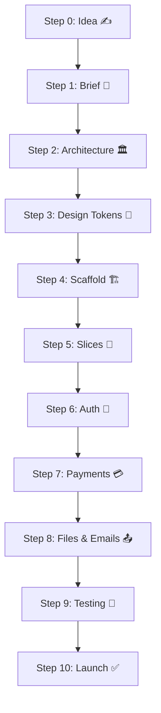

# 🗺️ Where Am I? — The Master Progress Tracker

> **This is the ONE page to open when you feel lost.**
> It turns the whole playbook into a single ordered path. Work top to bottom, tick the boxes, and you always know exactly what to type next.

---

## 🧭 The Full Journey at a Glance



**Reading order of the guides (reference, not sequence)**: `00` Phases → `01` Architecture → `02` Design → `03` Database → `04` Auth → `05` Payments → `06` Scale → `07` Bugs → `08` Prompts → `09` Templates → `10` Testing → `11` Files/Email → `12` SEO → `13` Apple UI → `14` Patterns.

---

# ✅ The Step-by-Step Checklist (Level 1 MVP Default)

## Step 0 — Start a New Idea (30 min)
📊 **Guide**: [00. Product Shipping OS](00_PRODUCT_SHIPPING_OS.md)

- [ ] Open `00_PRODUCT_SHIPPING_OS.md` and read the 6-Phase Pipeline (10 min).
- [ ] Answer the 5 Mandatory Questions out loud (target user, problem, business model, journey, non-goals).
- [ ] Write your non-goals list (at least 5 things you will NOT build).

**Done when**: You can pitch the product in 3 sentences.

```bash
# Create your project folder and git repo
mkdir my-app && cd my-app
git init
```

---

## Step 1 — Write the 1-Page Brief (1 hour)
📊 **Guide**: [09. Templates](09_TEMPLATES_AND_CHECKLISTS.md) (Template 1)

- [ ] Copy `PRODUCT_BRIEF.md` Template 1 into your project as `PRODUCT_BRIEF.md`.
- [ ] Fill in: target user, problem, value prop, pricing, happy path, in/out of scope.
- [ ] Give it to an AI with Prompt A from [08. Prompt Library](08_PROMPT_LIBRARY_AND_RECIPES.md) for review.

**Done when**: Brief fits on one page and non-goals exist.

---

## Step 2 — Pick Architecture & Plan Data (2 hours)
📊 **Guide**: [01. Architecture Tiers](01_ARCHITECTURE_TIERS.md)

- [ ] Run the Decision Flowchart → 99% of the time you start at **Level 1 (MVP)**.
- [ ] Copy Template 2 (`ARCHITECTURE.md`) and fill in your 3 tables (users + 1 feature + orders).
- [ ] List every route you need on paper first (`/`, `/dashboard`, `/api/items`...).

**Done when**: Schema documented with column types, no speculative tables.

---

## Step 3 — Lock the Visual Design (1–2 hours)
📊 **Guide**: [02. UX/UI Design System](02_UX_UI_DESIGN_SYSTEM.md)

- [ ] Copy the Design Tokens CSS block into your `globals.css`.
- [ ] Decide: dark or light mode default, the ONE accent color, the typeface.
- [ ] Copy Prompt B from [08](08_PROMPT_LIBRARY_AND_RECIPES.md) to generate `UX_UI_SPEC.md`.
- [ ] Skim the 7 Mandatory UI States — every screen must support them.

**Done when**: File `UX_UI_SPEC.md` exists with colors, fonts, spacing decided.

---

## Step 4 — Foundation Scaffold (2–4 hours)
📊 **Guides**: [03. Database](03_DATABASE_BACKEND_DISCIPLINE.md) · [04. Auth](04_AUTH_AND_SECURITY.md)

```bash
# 1. Create the Next.js app (TypeScript, App Router, Tailwind)
npx create-next-app@latest . --typescript --app --tailwind --src-dir

# 2. Install the lean stack
pnpm add drizzle-orm postgres zod
pnpm add -D drizzle-kit
pnpm add -D vitest @playwright/test supabase-js   # adjust to your picks

# 3. Connect to a free Postgres (Supabase or Neon) and put URL in .env
#    Then create your schema file and push it:
npx drizzle-kit generate
npx drizzle-kit push

# 4. Verify dev server boots clean
pnpm dev   # open http://localhost:3000 — zero console errors?
```

- [ ] Users table + one feature table exist in the real database.
- [ ] Basic layout shell renders (nav header + container).
- [ ] Linter passes.

**Done when**: `pnpm dev` works with DB connected and migration applied.

---

## Step 5 — Build Vertical Slices One at a Time (days)
📊 **Guides**: [03. Database](03_DATABASE_BACKEND_DISCIPLINE.md) · [08. Prompt D](08_PROMPT_LIBRARY_AND_RECIPES.md)

For **each** slice (Signup → Core create → View/Edit → Pay), always the same loop:

- [ ] Paste **Prompt D** into your AI with the slice name.
- [ ] Build UI + form + API + DB query together — never layers.
- [ ] Test the loop end-to-end in the browser your own hands.
- [ ] Write one integration test (see [10. Testing](10_TESTING_AND_QA_STRATEGY.md)).

**Done when**: A stranger could complete your primary user journey locally.

---

## Step 6 — Wire Auth & Tenant Security (half day)
📊 **Guide**: [04. Auth & Security](04_AUTH_AND_SECURITY.md)

```bash
# Clerk (fastest):
pnpm add @clerk/nextjs

# Better Auth (self-owned):
pnpm add better-auth
pnpm dlx @better-auth/cli generate
```

- [ ] Sessions verified **server-side** on every protected route.
- [ ] EVERY mutation scoped: `WHERE id = $1 AND user_id = $2`.
- [ ] Zod validation on every POST/PUT route.
- [ ] Rate limit on login / forgot-password / checkout.

**Done when**: You tamper URL `/api/projects/<other-user-id>` and get 403/404.

---

## Step 7 — Payments & Webhooks (half day)
📊 **Guide**: [05. Payments & Billing](05_PAYMENTS_AND_BILLING.md)

```bash
pnpm add stripe
pnpm add -D stripe-cli    # or install the Stripe CLI globally
stripe login
stripe listen --forward-to localhost:3000/api/webhooks/stripe
stripe trigger checkout.session.completed
```

- [ ] Hosted checkout (never custom checkout UI in MVP).
- [ ] Webhook signature verified + `processed_webhooks` idempotency table.
- [ ] `orders` ledger row written inside a DB transaction.

**Done when**: Sandbox buy works; duplicate webhook = no double credit.

---

## Step 8 — Files, Storage & Transactional Emails (half day)
📊 **Guide**: [11. Files, Storage & Emails](11_FILES_STORAGE_AND_EMAILS.md)

```bash
pnpm add @aws-sdk/client-s3 @aws-sdk/s3-request-presigner
pnpm add resend
```

- [ ] Presigned direct upload (browser → R2/S3, server never streams files).
- [ ] SPF + DKIM + DMARC DNS records added at your domain registrar.
- [ ] Welcome email sends from `@yourapp.com` and lands in **Inbox** (not spam).

**Done when**: Upload >4.5MB works and test email reaches a Gmail inbox.

---

## Step 9 — Testing & QA (half day)
📊 **Guide**: [10. Testing & QA](10_TESTING_AND_QA_STRATEGY.md)

```bash
pnpm vitest run            # integration tests against the real test DB
pnpm playwright test       # 1–2 E2E smoke tests of the money journey
npx playwright install chromium   # first time only
```

- [ ] Tenant-isolation test (User A cannot touch User B's data).
- [ ] Webhook idempotency test.
- [ ] One Playwright smoke test: land → signup → create → see it.

**Done when**: Full test suite green in under 60 seconds.

---

## Step 10 — Production Launch (half day)
📊 **Guides**: [06. Scale & DevOps](06_SCALING_AND_DEVOPS.md) · [09. Checklist](09_TEMPLATES_AND_CHECKLISTS.md) · [12. SEO](12_SEO_METADATA_AND_ANALYTICS.md)

- [ ] Run the **15-Point Production Readiness Checklist** in guide 09.
- [ ] `DATABASE_URL` production string with **pooler** connection.
- [ ] OG image (1200×630), sitemap, robots.txt live (guide 12).
- [ ] Sentry + PostHog receiving events (guide 12 §analytics).

```bash
# Deploy to Vercel (frontend + API)
pnpm add -g vercel
vercel --prod

# Or Railway: connect repo in dashboard, then push:
git remote add railway <your-railway-url>
git push railway main
```

**Done when**: Real signup + real (sandbox→live) payment works on the live domain. 🚀

---

## 🧯 When Something Breaks

- 📊 **Guide**: [07. Surgical Bug Fixing](07_BUG_FIXING_AND_HARDENING.md) — the 5-step protocol, < 20-line patches.
- 📊 **Guide**: [08. Prompt G](08_PROMPT_LIBRARY_AND_RECIPES.md) — copy-paste the Bug Fixer prompt into your AI.
- 📊 **Guide**: [06 § Observability](06_SCALING_AND_DEVOPS.md) — check Sentry stack trace first, guess never.

## 🪜 When to Scale Up (Later)

- 📊 **Guide**: [06. Scaling](06_SCALING_AND_DEVOPS.md) — only when you hit the measurable triggers (DB CPU > 70%, jobs > 5s). Never before.

---

## 💡 The 3 Rules for Using This Playbook

1. **Never skip a "Done when"** — it is the only defense against drift.
2. **One step per session** if you are tired; the tick boxes are your save game.
3. **Lost? Come back to this page.** Your next action is always the first unticked box.
